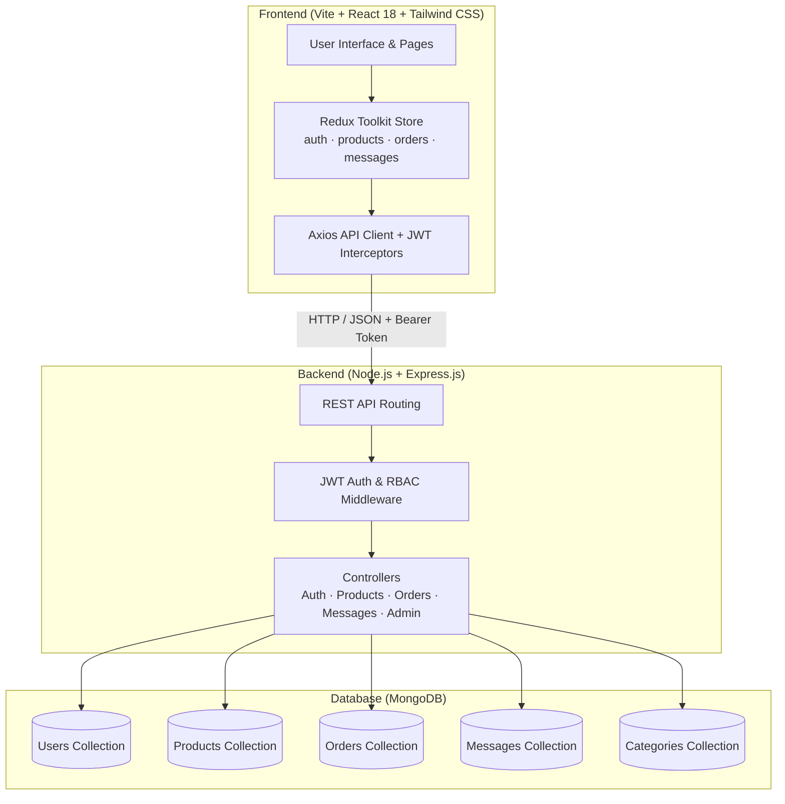

# 🌾 KisanBazar — Direct Farm-to-Consumer Agri-Tech Marketplace

> **Winner of the Full Stack Web Development Hackathon at the University of South Asia — Built with ❤️ by Team Terminator 🏆**

---

## 📌 Executive Summary

**KisanBazar** is a full-stack agri-tech web platform engineered to bridge the critical gap between farmers and consumers. By bypassing predatory middlemen, KisanBazar empowers local agricultural producers to create their own digital storefronts, list seasonal harvests, set fair prices, communicate directly with consumers via real-time messaging, and fulfill order requests transparently.

---

## 💡 The Challenge & Problem Statement

Farmers across regional agrarian belts face recurring bottlenecks:
* ❌ **Middleman Dependency**: Multiple layers of middlemen extract up to 40–60% of crop profit margins while inflating prices for end consumers.
* ❌ **Lack of Digital Presence**: Small-scale and heritage farmers lack accessible platforms to showcase their produce and farming practices.
* ❌ **Communication & Trust Gap**: Consumers rarely know the origin, harvest date, or chemical treatment of their produce.
* ❌ **Fragmented Order Handling**: Inefficient phone calls and unorganized order logistics lead to food waste and delayed payments.

### ✅ The KisanBazar Solution
* 🌾 **Farmer Profiles & Farm Showcases**: Verified farmer badges, farm sizes, heritage bio, and organic certifications.
* 🛒 **Consumer Marketplace**: Real-time multi-criteria filtering by produce category, price, and farm region.
* 📬 **Direct In-App Messaging**: Instant communication channel between growers and consumers for negotiations, harvest queries, and delivery coordination.
* 📦 **Streamlined Order Requests**: Transparent checkout flow with address verification and order tracking from dispatch to delivery.
* 🛡️ **Admin Governance & Moderation**: System metrics, produce moderation, user verification, and platform oversight.

---

## 🏗️ System Architecture



---

## 🧩 Features Overview

| Role | Core Capabilities |
| :--- | :--- |
| **👨🌾 Farmer** | Register farm profile, list harvests, specify unit pricing (`kg`, `quintal`, `dozen`), toggle stock, manage incoming order requests, chat with buyers. |
| **🛒 Consumer** | Search & filter produce, inspect harvest freshness & farmer credentials, place direct order requests, track order status, direct chat. |
| **🛠️ Admin** | Platform KPI analytics, user status moderation (verify/suspend), product approval/moderation, inspect all system orders. |
| **🔐 Auth** | Role-based Access Control (RBAC), salted bcrypt hashing, JWT token validation. |

---

## 🛠️ Technologies Used

* **Frontend**: React 18, Vite, Tailwind CSS, Redux Toolkit, React Router DOM v6, Lucide React, Axios
* **Backend**: Node.js, Express.js, Mongoose, JWT (`jsonwebtoken`), bcryptjs, Morgan, CORS, Dotenv
* **Database**: MongoDB (Atlas / Local)
* **Deployment Ready**: Modular structure optimized for Vercel / Render / Railway

---

## 🚀 Quick Start Guide

### Prerequisites
* **Node.js**: v18.0.0 or higher (`node -v`)
* **MongoDB**: Local MongoDB instance running on `mongodb://127.0.0.1:27017` or a MongoDB Atlas connection string.

---

### 1. Backend Setup

```bash
cd backend

# Install dependencies
npm install

# Configure environment variables
# Copy .env.example to .env (pre-configured defaults provided)

# Seed database with sample verified farmers, produce, orders & messages
npm run seed

# Start development server
npm run dev
# Server will run on http://localhost:5000
```

---

### 2. Frontend Setup

```bash
cd ../frontend

# Install dependencies
npm install

# Start Vite development server
npm run dev
# Frontend will run on http://localhost:5173
```

---

## 🔑 Demo Test Credentials (1-Click Login Ready)

| Role | Email | Password | Details |
| :--- | :--- | :--- | :--- |
| **👨🌾 Farmer (Nashik)** | `ramesh@farmer.com` | `Password123!` | Patel Organic Bio Farms (12 acres, verified) |
| **👨🌾 Farmer (Punjab)** | `gurpreet@farmer.com` | `Password123!` | Singh Golden Fields (Basmati & Wheat specialist) |
| **🛒 Consumer** | `priya@consumer.com` | `Password123!` | Consumer with active orders (Bengaluru) |
| **🛒 Consumer 2** | `rahul@consumer.com` | `Password123!` | Consumer with pending inquiries (New Delhi) |
| **🛠️ Admin** | `admin@kisanbazar.com` | `Password123!` | Team Terminator Super Administrator |

*(Note: The login page includes 1-click demo buttons to automatically populate these credentials for rapid demonstrations!)*

---

## 📡 REST API Specifications

### Authentication (`/api/auth`)
* `POST /api/auth/register` — Register a new farmer or consumer
* `POST /api/auth/login` — Authenticate and receive JWT token
* `GET /api/auth/me` — Get authenticated user details
* `PUT /api/auth/profile` — Update address or farm profile
* `GET /api/auth/farmer/:id` — Public farmer profile & their active produce

### Products (`/api/products`)
* `GET /api/products` — Filter & search marketplace produce (supports pagination, category, organic, price range, city)
* `GET /api/products/:id` — Single product details with farmer info
* `POST /api/products` — List produce (*Farmer only*)
* `PUT /api/products/:id` — Update produce (*Farmer/Admin*)
* `DELETE /api/products/:id` — Remove produce (*Farmer/Admin*)
* `PATCH /api/products/:id/toggle-stock` — Quick stock toggle (*Farmer only*)
* `GET /api/products/farmer/me` — List logged-in farmer's inventory (*Farmer only*)

### Orders (`/api/orders`)
* `POST /api/orders` — Place order request (*Consumer only*)
* `GET /api/orders/my-orders` — Get user's orders (Farmer sees incoming requests, Consumer sees placed orders)
* `GET /api/orders/:id` — Order status details
* `PATCH /api/orders/:id/status` — Update order fulfillment status (*Farmer/Admin*)

### Direct Messaging (`/api/messages`)
* `POST /api/messages` — Send message to grower or consumer
* `GET /api/messages/conversations` — Inbox contacts list with unread counters
* `GET /api/messages/conversation/:partnerId` — Message thread history

### Admin Portal (`/api/admin`)
* `GET /api/admin/stats` — Platform aggregates & total volume
* `GET /api/admin/users` — User directory with moderation filters
* `PATCH /api/admin/users/:id` — Verify farmer or suspend user
* `GET /api/admin/products` — Moderation produce review
* `PATCH /api/admin/products/:id/approve` — Toggle listing approval
* `GET /api/admin/orders` — Complete order log

---

## 🏆 Hackathon Credits
Built with passion by **Team Terminator** for the **Full Stack Web Development Hackathon at University of South Asia**.
